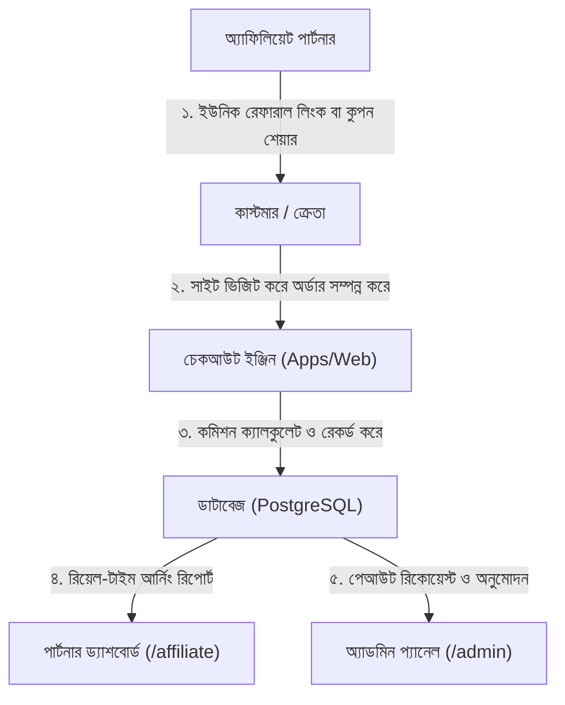

# প্রজেক্ট অডিট, টেকনিক্যাল আপগ্রেড ও কমার্শিয়াল প্রস্তাবনা
**প্ল্যাটফর্ম:** Denimisia Luxury E-Commerce & Digital Atelier  
**ডকুমেন্টের ধরন:** টেকনিক্যাল অডিট, নতুন ফিচার প্ল্যান, টাইমলাইন ও বাজেট কোটেশন  
**প্রস্তুত করা হয়েছে:** ক্লায়েন্ট ম্যানেজমেন্ট ও ডিসিশন মেকারদের জন্য  
**তারিখ:** নভেম্বর ২০২৬  
**স্ট্যাটাস:** চূড়ান্ত পর্যালোচনার জন্য অনুমোদিত  

---

## ১. মূল সারসংক্ষেপ এবং ৩-ধাপের কাজের বিভাজন (The 3-Pillar Matrix)

প্রজেক্টের কাজের পরিধি এবং বর্তমান অবস্থা যেন খুব সহজে ও পরিষ্কারভাবে বোঝা যায়, সেজন্য পুরো কাজকে **৩টি মূল পিলারে (Pillars)** ভাগ করা হয়েছে:

1. **[Pillar A] বর্তমানে কী কী অলরেডি করা আছে (Already Built & Functional):** ব্যাকএন্ড ও ডাটাবেজের মূল ইঞ্জিন সম্পূর্ণ রেডি।
2. **[Pillar B] জিপ ফাইলে কী কী আসেনি বা রিস্টোর করতে হবে (Gaps to Repair):** জিপিংয়ের সময় বাদ পড়া ফ্রন্টএন্ড UI Kit ও অ্যাডমিন পেজ মেরামত।
3. **[Pillar C] নতুন কী কী ফিচার তৈরি করতে হবে (New Features to Develop):** ক্লায়েন্টের চাহিদামতো ৮টি নতুন ফিচার, সম্পূর্ণ অ্যাফিলিয়েট প্রোগ্রাম ও ফুল SEO।

| **PILLAR A: বিদ্যমান (৪৫%)** | **PILLAR B: মেরামত ও রিস্টোর** | **PILLAR C: নতুন ফিচারসমূহ (৫৫%)** |
| :--- | :--- | :--- |
| • ৩৩+ NestJS API মডিউল | • ফ্রন্টএন্ড UI Kit তৈরি | • ৮টি নতুন স্টোর আপগ্রেড |
| • ৫১টি Supabase DB টেবিল | • অ্যাডমিন লগইন পেজ তৈরি | • কাস্টম অ্যাফিলিয়েট ইঞ্জিন |
| • কোর পেজ রাউটিং ও কার্ট | • ড্যাশবোর্ড উইজেট তৈরি | • গুগল রিচ স্ন্যাপশট ও SEO |
| • ফিট ইঞ্জিন ও ডেটা টাইপ | • সেশন হ্যান্ডশেক ফিক্স | • লাইট ও কাস্টমার-ফ্রেন্ডলি UI |

### শতকরা কাজের অগ্রগতি ও বাকি কাজের বিশ্লেষণ (%)

| সিনারিও / অবস্থা | বর্তমান সম্পন্ন কাজ (%) | বাকি কাজ (%) | কী কী কাজ বাকি রয়েছে |
| :--- | :---: | :---: | :--- |
| **বর্তমান বাস্তবতা (ফাইল না পাওয়া গেলে)** | **~৪৫% সম্পন্ন** | **~৫৫% বাকি** | মিসিং UI কম্পোনেন্ট নতুন করে তৈরি + ৮টি নতুন ফিচার + অ্যাফিলিয়েট সিস্টেম + ফুল SEO |
| **ফাস্ট-ট্র্যাক (ক্লায়েন্ট মিসিং ফাইল দিলে)** | **~৫৫% সম্পন্ন** | **~৪৫% বাকি** | রিস্টোরেশন বাদ দিয়ে সরাসরি ৮টি নতুন ফিচার + অ্যাফিলিয়েট প্রোগ্রাম + SEO |

---

## ২. Pillar A: বর্তমানে সিস্টেমে কী কী অলরেডি করা আছে (Already Built)

প্রজেক্টের মূল ইঞ্জিন ও আর্কিটেকচার অত্যন্ত শক্তিশালী এবং আধুনিক। নিচের অংশগুলো ১০০% তৈরি এবং কার্যকর অবস্থায় রয়েছে:

* **১. ব্যাকএন্ড API সার্ভার (`apps/api`):**
  * এন্টারপ্রাইজ গ্রেড **NestJS 11** ফ্রেমওয়ার্কে তৈরি।
  * **৩৩টি কোর বিজনেস মডিউল সম্পূর্ণ রেডি:** ক্যাটালগ, প্রোডাক্টস, ভ্যারিয়েন্টস, ক্যাটাগরি, কালেকশন, বান্ডেল, ইনভেন্টরি স্টক, কার্ট, অর্ডার প্রসেসিং, পাঠাও কুরিয়ার ইন্টিগ্রেশন (Pathao Aladdin API), রিটার্ন ম্যানেজমেন্ট, রিভিউ ব্যাকএন্ড, CMS হাব, মিডিয়া আপলোড এবং কাস্টমার চ্যাটবট।
* **২. ডাটাবেজ ও ডেটা লেয়ার:**
  * ক্লাউড হোস্টেড **PostgreSQL (Supabase)**-এ **৫১টি ডাটাবেজ টেবিল** সক্রিয় রয়েছে।
  * ৫৭০টির বেশি লাইভ প্রোডাক্ট SKU ও ভ্যারিয়েন্ট ডাটাবেজে সংরক্ষিত আছে।
  * Prisma ORM এর সাথে ব্যাকএন্ড সম্পূর্ণ কানেক্টেড।
* **৩. ফ্রন্টএন্ড কোর আর্কিটেকচার (`apps/web`):**
  * লেটেস্ট **Next.js 16 (App Router)** এবং **React 19** ফ্রেমওয়ার্ক।
  * সব পেজের লিঙ্ক ও স্ট্রাকচার বিদ্যমান: Shop (`/shop`), Collections, Product Details (`/products/[slug]`), Customer Account (`/account`), Checkout Flow (`/checkout`), Wishlist, Order Tracking (`/track-order`)।
  * স্টেট ম্যানেজমেন্টের জন্য **Zustand** এবং **TanStack Query** কনফিগার করা।
* **৪. শেয়ার্ড প্যাকেজসমূহ (`packages/`):**
  * `@repo/fit-engine`: কাস্টম ডেনিম সাইজিং ক্যালকুলেটর ও ইন্টারেক্টিভ বডি-ফিট ইঞ্জিন।
  * `@repo/types`: সব শেয়ার্ড টাইপস্ক্রিপ্ট ডেটা মডেল ও ইন্টারফেস।

---

## ৩. Pillar B: কী কী ঠিক বা রিস্টোর করতে হবে (Repair & Restoration Scope)

আপনাদের আগের ডেভেলপার বা সোর্স থেকে কোড জিপ করার সময় ফ্রন্টএন্ডের UI লেয়ারের কিছু ফাইল বাদ পড়েছে। প্ল্যাটফর্মটি লাইভ রান করার জন্য এগুলো রিস্টোর করতে হবে:

| কম্পোনেন্ট | চিহ্নিত সমস্যা | করণীয় কারিগরি পদক্ষেপ |
| :--- | :--- | :--- |
| **স্টোরফ্রন্ট UI Kit (`apps/web/components/`)** | জিপ ফাইলে আসেনি | সম্পূর্ণ লেআউট UI Kit নতুন করে তৈরি: Navigation Bar, Mega-menu, Footer, Slide-out Cart Drawer, Global App Providers, Chat Bubble, Splash Gate। |
| **অ্যাডমিন লগইন (`apps/admin/app/login/`)** | পেজ ফাইল মিসিং | ডেডিকেটেড `/login` পেজ তৈরি এবং ব্যাকএন্ড API এর সাথে NextAuth সেশন কানেক্ট করা। |
| **অ্যাডমিন অ্যানালিটিক্স উইজেট (`apps/admin`)** | ড্যাশবোর্ড উইজেট নেই | ড্যাশবোর্ডের চার্ট ও টেবিল কম্পোনেন্ট তৈরি: `MetricCard`, `SalesChart`, `TopCategoriesList`, `TopProductsList`, এবং `LatestOrdersTable`। |
| **অ্যাডমিন কনফিগারেশন** | `package.json` ছিল না | Turborepo পাইপলাইনের সাথে মিলিয়ে নতুন প্যাকেজ ফাইল কনফিগার করা হয়েছে। |
| **ডাটাবেজ পয়েন্টার** | অকার্যকর ডিপেন্ডেন্সি | মিসিং প্যাকেজের বদলে সরাসরি লাইভ ডাটাবেজ থেকে Prisma Client ম্যাপিং করা হয়েছে। |

---

## ৪. Pillar C: নতুন কী কী তৈরি করতে হবে (New Features & Growth Roadmap)

এই অংশে রয়েছে **ক্লায়েন্টের চাহিদামতো ৮টি নতুন স্টোর আপগ্রেড**, **কাস্টম অ্যাফিলিয়েট মার্কেটিং প্রোগ্রাম**, এবং **পূর্ণাঙ্গ এসইও আর্কিটেকচার**।

> [!NOTE]
> **ক্লায়েন্টের নিজস্ব পছন্দের স্বাধীনতা (Custom Direction):**  
> নিচে বর্ণিত ফিচারসমূহ আমাদের দীর্ঘদিনের ই-কমার্স অভিজ্ঞতার আলোকে সর্বোচ্চ সেলস বৃদ্ধির জন্য সাজানো হয়েছে। তবে **ক্লায়েন্টের যদি নিজস্ব কোনো ডিজাইন পছন্দ, ব্র্যান্ড রেফারেন্স বা বিশেষ কোনো আইডিয়া থাকে**, তবে তা আমাদের জানালেই আমরা শতভাগ ক্লায়েন্টের পছন্দ অনুযায়ী কাস্টমাইজ করে দেবো।

---

### পার্ট ১: ক্লায়েন্টের ৮টি নির্দিষ্ট আপগ্রেড (লাইভ সাইট denimisia.com এর সাথে সরাসরি তুলনা)

সরাসরি **[denimisia.com](https://denimisia.com/)** লাইভ ওয়েবসাইট ভিজিট করে দেখা গেছে, সাইটটি একটি আর্ট ম্যাগাজিনের মতো সুন্দর হলেও সাধারণ বাংলাদেশি ক্রেতাদের সহজে কেনাকাটা করার জন্য প্রয়োজনীয় ফিচারগুলো এতে নেই। নিচে লাইভ সাইটের সাথে নতুন আপগ্রেডের সরাসরি তুলনা তুলে ধরা হলো:

| ফিচার | লাইভ সাইটের বর্তমান অবস্থা | নতুন আপগ্রেডে যেভাবে করা হবে |
| :--- | :--- | :--- |
| **১. Background Change** | ডার্ক ও হেভি (`#030302`, bg-ink/50) | প্রিমিয়াম আইভরি ও ক্লিন হোয়াইট (`#FAFAF8`) |
| **২. Customer-Friendly UI** | হাই-আর্ট ম্যাগাজিন লুক (১০ পিক্সেল ফন্ট) | সহজ, স্পষ্ট ও দ্রুত মোবাইল-ফ্রেন্ডলি শপিং |
| **৩. Coupon Option** | কার্ট/চেকআউটে কুপন দেওয়ার ঘর নেই | ইনস্ট্যান্ট কুপন যাচাই ও ডিসকাউন্ট হিসাব |
| **৪. Pop-up Message** | কোনো অফার বা লিড পপআপ নেই | টাইমড ও এক্সিট-ইনটেন্ট ডিসকাউন্ট পপআপ |
| **৫. Hero Product Spotlight** | সাধারণ ক্যাটাগরি গ্রিড মাত্র | ফ্ল্যাগশিপ প্রোডাক্টের হাইলাইট ও কুইক-বাই |
| **৬. Review Option** | ০ রিভিউ, কোনো স্টার রেটিং নেই | কাস্টমার স্টার রেটিং ও ভেরিফাইড রিভিউ |
| **৭. Sold-Out Counter** | স্টক বা তাগিদের কোনো বার্তা নেই | লাইভ ব্যাজ ("X Pcs Sold", "Only 2 Left") |
| **৮. Trending Meter** | জনপ্রিয় প্রোডাক্ট চেনার উপায় নেই | ডাইনামিক "🔥 Trending Now" হট মিটার |

#### ১. Background Color Customization (ব্যাকগ্রাউন্ড পরিবর্তন):
* **বর্তমান অবস্থা:** লাইভ সাইটে ডার্ক `#030302` কালার ও হেভি ব্যাকড্রপ ব্যবহার করা হয়েছে, যার কারণে ডেনিম জিন্সের আসল ওয়াশ ও ফেব্রিকের টেক্সচার স্পষ্ট বোঝা যায় না।
* **আপগ্রেড:** প্রিমিয়াম, উজ্জ্বল ও সফট নিউট্রাল কালার (Warm Ivory / Pure White `#FAFAF8`) যুক্ত করা হবে এবং অ্যাডমিন প্যানেল থেকেই যেকোনো সময় ব্যাকগ্রাউন্ডের টোন পরিবর্তনের সুবিধা থাকবে।

#### ২. Light & Customer-Friendly UX (সহজ ও গ্রাহক-বান্ধব ওয়েবসাইট):
* **বর্তমান অবস্থা:** সাইটটি সাধারণ শপিং সাইটের মতো নয়—অতিরিক্ত ছোট ফন্ট (১০ পিক্সেল), কম কনট্রাস্ট, সরাসরি বাটন নেই। সাধারণ ক্রেতারা সাইটে ঢুকে সাইজ সিলেক্ট বা অর্ডার করতে দ্বিধায় পড়েন।
* **আপগ্রেড:** স্পষ্ট ও বড় টাইপোগ্রাফি, পরিষ্কার কালার সোয়াচ, স্পষ্ট **"Add to Cart"** বাটন, এক ক্লিকে ক্যাটাগরি ফিল্টারিং এবং মোবাইলে সুপার-ফাস্ট স্মুথ ব্রাউজিং।

#### ৩. Coupon Option (কুপন ও ডিসকাউন্ট অপশন):
* **বর্তমান অবস্থা:** কার্ট বা চেকআউটে কোনো প্রোমোকোড বা ভাউচার ব্যবহারের জায়গা নেই।
* **আপগ্রেড:** স্লাইড-আউট কার্ট এবং চেকআউট দুই জায়গাতেই আকর্ষণীয় প্রোমোকোড বক্স থাকবে। কোড দেওয়ার সাথে সাথে স্বয়ংক্রিয়ভাবে ডিসকাউন্ট মাইনাস হয়ে মোট টাকা আপডেট হবে।

#### ৪. Pop-up Message (প্রমোশনাল পপআপ মেসেজ):
* **বর্তমান অবস্থা:** নতুন ভিজিটরদের আকৃষ্ট করার কোনো ওয়েলকাম অফার বা ডিসকাউন্ট মেসেজ নেই।
* **আপগ্রেড:** ওয়েবসাইটে ঢোকার ৫ সেকেন্ড পর অথবা সাইট বন্ধ করার সময় (Exit-intent) চমৎকার পপআপ আসবে (যেমন: *"আপনার প্রথম অর্ডারে পান ১০% ছাড়!"*) যা কাস্টমারের মোবাইল নম্বর/ইমেইল সংগ্রহ করবে।

#### ৫. Highlight Hero Product (হিরো প্রোডাক্ট স্পটলাইট):
* **বর্তমান অবস্থা:** হোমপেজে ব্যানার পার হলেই সাধারণ প্রোডাক্ট লিস্ট চলে আসে। সিগনেচার প্রোডাক্টকে আলাদা করে তুলে ধরার সুযোগ নেই।
* **আপগ্রেড:** হোমপেজে বিশেষ একটি **"Hero Spotlight"** সেকশন থাকবে, যেখানে সেরা বা নতুন ডেনিমটির বিভিন্ন কোণের ছবি, ফিটিং ডিটেইলস এবং পেজ না বদলেই এক ক্লিকে সাইজ বেছে অর্ডার করার বাটন থাকবে।

#### ৬. Review Option (কাস্টমার রিভিউ ও স্টার রেটিং):
* **বর্তমান অবস্থা:** প্রোডাক্ট পেজে কোনো স্টার রেটিং বা কাস্টমার মতামত নেই। বাংলাদেশে কাস্টমাররা রিভিউ না দেখলে অনলাইনে সহজে ভরসা পান না।
* **আপগ্রেড:** ১ থেকে ৫ স্টার রেটিং, ভেরিফাইড বায়ার ব্যাজ, কাস্টমারদের কমেন্ট ও ছবি আপলোড করার পূর্ণাঙ্গ রিভিউ সিস্টেম (যা গুগলেও সরাসরি স্টার রেটিং হিসেবে দেখা যাবে)।

#### ৭. How Many Pcs Sold Out (স্টক ও বিক্রির তাগিদ ব্যাজ):
* **বর্তমান অবস্থা:** সাধারণ দাম ছাড়া স্টকের কোনো তাগিদ নেই।
* **আপগ্রেড:** প্রোডাক্টের গায়ে রিয়েল-টাইম ব্যাজ ভাসবে: **`"38 Pcs Sold Out"`**, **`"Only 2 Left in Size 32"`**, অথবা **`"Restocking Soon"`**—যা কাস্টমারকে দ্রুত অর্ডার করতে উৎসাহিত করবে।

#### ৮. Trending Meter (ট্রেন্ডিং ও হট প্রোডাক্ট মিটার):
* **বর্তমান অবস্থা:** সব প্রোডাক্ট একই রকম দেখায়, কোনটা সবচেয়ে বেশি চলছে তা বোঝার উপায় নেই।
* **আপগ্রেড:** সর্বোচ্চ বিক্রিত প্রোডাক্টগুলোর উপর **"🔥 Trending / High Demand"** ভিজ্যুয়াল মিটার থাকবে, যা ক্রেতাদের সহজেই ট্রেন্ডি পোশাক বেছে নিতে সাহায্য করবে।

---

### পার্ট ২: সম্পূর্ণ নিজস্ব Affiliate Marketing Program (End-to-End)

সোশ্যাল মিডিয়া ইনফ্লুয়েন্সার ও পার্টনারদের মাধ্যমে বাড়তি বিজ্ঞাপনী খরচ ছাড়াই বিক্রি বাড়ানোর জন্য একটি সম্পূর্ণ নিজস্ব অ্যাফিলিয়েট সিস্টেম তৈরি করা হবে (কোনো থার্ড-পার্টি সফটওয়্যারের মাসিক ডলার ফি দিতে হবে না)।

* **ইনফ্লুয়েন্সার রেজিস্ট্রেশন ও পোর্টাল (`/affiliate`):** যে কেউ পার্টনার হওয়ার জন্য সাইন-আপ করতে পারবে।
* **পার্টনার নিজস্ব ড্যাশবোর্ড:**
  * নিজস্ব ট্র্যাকিং রেফারাল লিংক (যেমন: `denimisia.com/?ref=RAHUL20`)।
  * কাস্টমারদের ডিসকাউন্ট দেওয়ার জন্য নিজস্ব স্পেশাল কুপন কোড (যেমন: `RAHUL10`)।
  * রিয়েল-টাইম রিপোর্ট: মোট কতজন ক্লিক করেছে, কতটি অর্ডার হয়েছে, মোট কত টাকা আয় হয়েছে এবং কত টাকা ব্যালেন্স বাকি আছে।
  * সরাসরি বিকাশ, নগদ বা ব্যাংক একাউন্টে টাকা উইথড্র করার রিকোয়েস্ট ফর্ম।
* **অ্যাডমিন কন্ট্রোল প্যানেল:**
  * অ্যাডমিন যেকোনো পার্টনারকে অনুমোদন বা বাতিল করতে পারবেন।
  * কমিশন পারসেন্টেজ সেট করতে পারবেন (যেমন: প্রতিটি বিক্রিতে ৮% থেকে ১৫% কমিশন)।
  * পার্টনারদের জমানো টাকা বিকাশ/নগদে পাঠিয়ে পেমেন্ট "Paid" মার্ক করতে পারবেন।

---

### পার্ট ৩: পূর্ণাঙ্গ SEO ও গুগল সার্চ অপ্টিমাইজেশন

* **Google Rich Snippets (Schema.org):** গুগল সার্চ ইঞ্জিনের সাথে প্রোডাক্ট কোড যুক্ত করা হবে, যাতে গুগলে সার্চ করলেই প্রোডাক্টের ছবির পাশে **দাম (Price), স্টক অবস্থা (In Stock) এবং রিভিউ স্টার (★★★★★)** সরাসরি দেখা যায়।
* **Dynamic Social Share Cards:** ফেসবুক, হোয়াটসঅ্যাপ বা ইনস্টাগ্রামে ওয়েবসাইটের যেকোনো প্রোডাক্টের লিঙ্ক শেয়ার করলে স্বয়ংক্রিয়ভাবে ঝকঝকে বড় ছবি, পণ্যের নাম ও দাম প্রিভিউ আকারে ভেসে উঠবে।
* **Automated XML Sitemaps:** ওয়েবসাইটে নতুন কোনো প্রোডাক্ট যোগ হলেই স্বয়ংক্রিয়ভাবে গুগল সার্চ কনসোলে ইনডেক্সিংয়ের নোটিফিকেশন চলে যাবে।
* **Core Web Vitals & Speed:** সব ছবি WebP ফরম্যাটে অপ্টিমাইজ করা হবে, যাতে সাধারণ ৩জি/৪জি মোবাইলেও ওয়েবসাইট **১.৫ সেকেন্ডের মধ্যে চোখের পলকে লোড হয়**।

---

## ৫. কাজের সময়সীমা ও ডেলিভারি প্ল্যান (Timeline)

পুরো কাজটি **৪টি সুনির্দিষ্ট ধাপে (Sprints)** সম্পন্ন করা হবে:

* 🗓️ **ধাপ ১ (১ম – ৪র্থ দিন):** মিসিং UI রিস্টোর ও অ্যাডমিন রিকভারি  
* 🗓️ **ধাপ ২ (৫ম – ৯ম দিন):** ক্লায়েন্টের ৮টি নতুন ফিচার ও লাইট থিম বাস্তবায়ন  
* 🗓️ **ধাপ ৩ (১০ম – ১৩তম দিন):** সম্পূর্ণ কাস্টম অ্যাফিলিয়েট মার্কেটিং সিস্টেম তৈরি  
* 🗓️ **ধাপ ৪ (১৪তম – ১৬তম দিন):** ফুল SEO, গুগল রিচ স্ন্যাপশট, স্পিড টেস্টিং ও লাইভ হ্যান্ডওভার  

* **সর্বমোট প্রজেক্টের সময়সীমা:** **১৬ কার্যদিবস (প্রায় ২.৫ থেকে ৩ সপ্তাহ)**।

---

## ৬. বাজেট ও কমার্শিয়াল কোটেশন (Commercial Quotation)

### কাজের ধাপভিত্তিক মাইলস্টোন সামারি

| ধাপ / মাইলস্টোন | কাজের বিবরণ | সময়সীমা |
| :--- | :--- | :---: |
| **মাইলস্টোন ১** | **কোর রিস্টোরেশন:** ফ্রন্টএন্ড UI Kit (Navbar, Footer, Cart), অ্যাডমিন লগইন ও ড্যাশবোর্ড | ৪ দিন |
| **মাইলস্টোন ২** | **৮টি স্টোর আপগ্রেড:** লাইট থিম, ব্যাকগ্রাউন্ড, কুপন, পপআপ, রিভিউ, হিরো স্পটলাইট, স্টক ব্যাজ | ৫ দিন |
| **মাইলস্টোন ৩** | **অ্যাফিলিয়েট মার্কেটিং প্রোগ্রাম:** ইনফ্লুয়েন্সার পোর্টাল, ট্র্যাকিং লিংক/কুপন, ড্যাশবোর্ড ও পেআউট | ৪ দিন |
| **মাইলস্টোন ৪** | **SEO ও পারফরম্যান্স:** গুগল রিচ স্ন্যাপশট, সোশ্যাল শেয়ার কার্ড, স্পিড অপ্টিমাইজেশন ও ফাইনাল লাইভ | ৩ দিন |
| **সর্বমোট প্রজেক্ট সময়সীমা** | সম্পূর্ণ প্রজেক্ট হস্তান্তর (Turnkey Delivery) | **১৬ দিন** |

---

### ক্লায়েন্টের সুবিধার্থে ২টি বিকল্প অপশন (Turnkey vs. Fast-Track)

* **অপশন ১ — টার্নকি হ্যান্ডওভার (যদি আগের ফাইলগুলো না পাওয়া যায় - রেকমেন্ডেড):**  
  আমাদের ইঞ্জিনিয়ারিং টিমই বাদ পড়া সব ফ্রন্টএন্ড ও অ্যাডমিন কম্পোনেন্ট বানিয়ে দেবে এবং সাথে ৮টি নতুন ফিচার, অ্যাফিলিয়েট ইঞ্জিন ও SEO শেষ করে দেবে।  
  * **মোট বাজেট:** **৳ ৫০,০০০ BDT ($440 USD)**  
  * **সময়সীমা:** **১৬ কার্যদিবস** (বাকি থাকা ৫৫% কাজের জন্য)

* **অপশন ২ — ফাস্ট-ট্র্যাক (যদি ক্লায়েন্ট আগের ডেভেলপার থেকে মিসিং `components/` ফোল্ডার এনে দিতে পারেন):**  
  আগের ডেভেলপার যদি মিসিং ফ্রন্টএন্ড ফোল্ডারটি দিয়ে দেয়, তবে **মাইলস্টোন ১ এর ১২,০০০ টাকা খরচ সম্পূর্ণ মওকুফ হয়ে যাবে**! আমরা সরাসরি নতুন ৮টি ফিচার, অ্যাফিলিয়েট প্রোগ্রাম ও এসইও তে কাজ শুরু করব।  
  * **মোট বাজেট:** মাত্র **৳ ৩৮,০০০ BDT ($335 USD)**  
  * **সময়সীমা:** মাত্র **১১ কার্যদিবস** (বাকি থাকা ৪৫% কাজের জন্য)

---

## ৭. পেমেন্ট টার্মস ও কিস্তি (Payment Terms)

পেমেন্ট প্রক্রিয়াকে সহজ ও ঝামেলাহীন রাখতে মোট **৳ ৫০,০০০** বাজেটকে **২টি সমান কিস্তিতে (৫০% - ৫০%)** ভাগ করা হয়েছে:

* **১ম কিস্তি — কাজ শুরুর অগ্রিম (৫০%):** **৳ ২৫,০০০ BDT ($220 USD)**  
  *চুক্তি চূড়ান্ত হওয়া, ওয়ার্কস্পেস সেটআপ এবং কাজ শুরুর সময় প্রদেয়।*
* **২য় কিস্তি — সম্পূর্ণ কাজ হস্তান্তর ও ফাইনাল লাইভ (৫০%):** **৳ ২৫,০০০ BDT ($220 USD)**  
  *সবগুলো নতুন ফিচার সফলভাবে সম্পন্ন, ক্লায়েন্ট ভেরিফিকেশন ও লাইভ সার্ভারে হ্যান্ডওভারের পর প্রদেয়।*

---

### যে যে সার্ভিস গ্যারান্টি অন্তর্ভুক্ত রয়েছে:
* **৩০ দিনের ফ্রি টেকনিক্যাল সাপোর্ট ও বাগ-ফিক্স গ্যারান্টি:** কাজ লাইভ হওয়ার পরবর্তী ৩০ দিন যেকোনো টেকনিক্যাল বা ফাংশনাল ত্রুটি সম্পূর্ণ ফ্রিতে সমাধান করে দেওয়া হবে।
* **সম্পূর্ণ সোর্স কোড হস্তান্তর:** প্রজেক্ট শেষে ক্লিন গিট রিপোজিটরি ও সব কোডের পূর্ণ মালিকানা ক্লায়েন্টকে হস্তান্তর করা হবে।
* **অ্যাডমিন ট্রেনিং সেশন:** ওয়েবসাইট ও অ্যাডমিন প্যানেল পরিচালনার জন্য (প্রোডাক্ট আপলোড, কুপন তৈরি ও অ্যাফিলিয়েট পেমেন্ট যাচাই) সরাসরি লাইভ ট্রেনিং সেশন।
