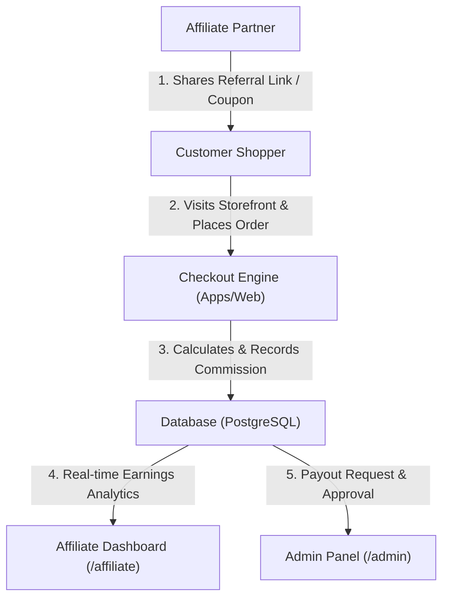

# PROJECT AUDIT, TECHNICAL ENHANCEMENT & COMMERCIAL PROPOSAL
**Platform:** Denimisia Luxury E-Commerce & Digital Atelier  
**Document Type:** Technical Audit, Enhancement Scope, Milestone Roadmap & Quotation  
**Prepared For:** Client Management  
**Date:** November 2026  
**Status:** Approved for Client Review  

---

## 1. Executive Summary & The 3-Pillar Project Matrix

To ensure absolute clarity for both business stakeholders and engineering teams, this proposal categorizes the entire scope into **Three Distinct Pillars**:
1. **[Pillar A] Already Built & Functional Subsystems:** Fully tested backend engines and database architecture.
2. **[Pillar B] Repair & Restoration Scope:** Reconstructing UI layers omitted during the previous export.
3. **[Pillar C] New Features to Develop:** The 8 client store upgrades, custom affiliate engine, and full SEO.

| **PILLAR A: EXISTING (45%)** | **PILLAR B: FIX & RESTORE** | **PILLAR C: NEW FEATURES (55%)** |
| :--- | :--- | :--- |
| • 33+ NestJS API Modules | • Reconstruct UI Kit | • 8 Store Enhancements |
| • 51 Supabase DB Tables | • Rebuild Admin Login Page | • Custom Affiliate Engine |
| • Core Page Routing & E2E | • Rebuild Analytics Widgets | • Google Rich Snippets & SEO |
| • Fit Engine & Types | • Session Cookie Namespace | • Light UI Customer Overhaul |

### Work Progress & Remaining Effort Analysis (%)

| Scenario | Already Completed (%) | Remaining Work to Deliver (%) | Key Deliverables Remaining |
| :--- | :---: | :---: | :--- |
| **Current Reality (As-Is Export)** | **~45% Done** | **~55% Remaining** | Rebuilding missing UI components + 8 New Features + Affiliate System + Full SEO |
| **Fast-Track (If Client Provides Missing Files)** | **~55% Done** | **~45% Remaining** | Skipping restoration — directly developing the 8 New Features + Affiliate + SEO |

---

## 2. Pillar A: Subsystems Already Built & Functional (Already Built)

The core architecture of the platform is solid and modern. The following subsystems are completely developed and operational:

* **1. Backend API (`apps/api`):**
  * Built on **NestJS 11** with clean enterprise architecture and modular controllers.
  * **33 Core Business Modules** fully developed: Catalog, Products, Product Variants, Categories, Collections, Bundles, Inventory Management, Cart, Orders, Courier Integration (Pathao Aladdin API), Customer Returns, Customer Reviews backend, CMS Hub, Uploads/Media Management, and Support Chatbot.
* **2. Database & Data Layer:**
  * Hosted **PostgreSQL (Supabase)** with **51 database models** configured.
  * Catalog snapshot verified with 570+ product SKUs, taxonomy relationships, and foreign keys.
  * Prisma ORM fully connected with `@prisma/client`.
* **3. Storefront Core Architecture (`apps/web`):**
  * Modern **Next.js 16 (App Router)** & **React 19** foundation.
  * All URL route handlers and pages are present: Shop (`/shop`), Collections, Product Details (`/products/[slug]`), Customer Account (`/account`), Checkout Flow (`/checkout`), Wishlist, Order Tracking (`/track-order`).
  * Global state management configured via **Zustand** and **TanStack Query**.
* **4. Shared Packages (`packages/`):**
  * `@repo/fit-engine`: Custom denim sizing, silhouette calculator, and interactive body-fit preset library.
  * `@repo/types`: Centralized TypeScript data models and DTO interfaces.

---

## 3. Pillar B: Technical Repair & Restoration Scope (Repair Scope)

The source archive received had a few critical UI layers omitted during the code packaging process. These must be restored to bring the platform back to 100% operational condition:

| Component | Issue Identified | Exact Repair Action |
| :--- | :--- | :--- |
| **Storefront Components (`apps/web/components/`)** | Omitted from zip package | Reconstruct the complete layout UI kit: Navigation Bar, Mega-menu, Footer, Slide-out Cart Drawer, Global App Providers, Chat Bubble, Splash Gate. |
| **Admin Login (`apps/admin/app/login/`)** | Missing route file | Build the dedicated `/login` page and integrate NextAuth session exchange with NestJS `/auth/login`. |
| **Admin Analytics Widgets (`apps/admin/app/(dashboard)`)** | Missing sub-components | Reconstruct Dashboard widgets: `MetricCard`, `SalesChart`, `TopCategoriesList`, `TopProductsList`, and `LatestOrdersTable`. |
| **Admin Configuration** | Missing `package.json` | Recreated and aligned with monorepo Turborepo pipeline. |
| **Database Workspace Pointer** | Dead workspace reference | Removed legacy `"database": "workspace:*"` dependency in favor of direct Prisma client generation. |

---

## 4. Pillar C: New Features & Growth Roadmap (New Features)

This pillar encompasses the **8 Client Feature Requirements**, the **End-to-End Affiliate Marketing Engine**, and the **Full SEO Overhaul**.

> [!NOTE]
> **Client Flexibility & Custom Direction:**  
> The technical architectures and feature designs proposed below represent our recommended best practices for high-converting e-commerce. However, **our team is 100% open to client choices and preferences.** If you have specific design inspirations, custom layout benchmarks, or alternative feature behaviors in mind, please share them with us and we will implement them accordingly.

---

### Part 1: The 8 Specific Client Feature Upgrades (Mapped to Live Site: https://denimisia.com/)

A live inspection of **https://denimisia.com/** shows that while the current site has an avant-garde editorial feel, it lacks modern e-commerce conversion triggers essential for consumer sales in Bangladesh. Below is the direct comparison between the current live site and the proposed upgrades:

| Feature | Current Live Site (denimisia.com) | Proposed Upgrade Implementation |
| :--- | :--- | :--- |
| **1. Background Change** | Dark mood (`#030302`, bg-ink/50) | Warm Ivory / Crisp White (`#FAFAF8`) |
| **2. Customer-Friendly UI** | High-art editorial lookbook (10px) | Modern, accessible, mobile-first UX |
| **3. Coupon Option** | No promo-code box in cart/checkout | Real-time discount engine & validator |
| **4. Pop-up Message** | No promotional/lead capture popup | Timed & exit-intent discount popups |
| **5. Hero Product Spotlight** | Standard category grid only | High-impact hero showcase & quick-buy |
| **6. Review Option** | 0 customer reviews, no star ratings | Star ratings & verified buyer reviews |
| **7. Sold-Out Counter** | Static price only, no stock urgency | Live badges ("X Pcs Sold", "Only 2 Left") |
| **8. Trending Meter** | No popularity indicator | Dynamic "🔥 Trending Now" hot meter |

#### 1. Background Color Customization (Live Site Fix):
* **Current State:** The live site uses a dark `#030302` theme-color and heavy muted grey backdrop that makes denim fabric textures harder to appreciate.
* **Upgrade:** Transition to an elegant, bright neutral palette (Warm Ivory / Pure White `#FAFAF8`) with configurable background tone controls in the Admin panel.

#### 2. Light & Customer-Friendly UX Overhaul:
* **Current State:** The live site is styled like an abstract fashion portfolio (ultra-small 10px uppercase fonts, low contrast, no clear product tags), making navigation difficult for regular shoppers.
* **Upgrade:** Optimize typographic hierarchy, add clear color swatches, visible "Add to Bag" buttons, one-tap mobile filters, and sticky navigation.

#### 3. Advanced Coupon & Discount System:
* **Current State:** Live cart drawer and checkout flow lack any promo-code input field.
* **Upgrade:** Interactive coupon box in both the **Slide-out Cart Drawer** and **Checkout Page** with instant discount calculation, minimum spend rules, and backend anti-abuse validation.

#### 4. Promotional & Announcement Pop-ups:
* **Current State:** No marketing modals on the live site to capture leads or drive immediate purchases.
* **Upgrade:** Timed (5s delay) or exit-intent popups offering first-purchase discounts (e.g., "Get 10% OFF your first denim") integrated with Resend automated emails.

#### 5. Hero Product Spotlight Showcase:
* **Current State:** Live homepage transitions directly from hero cover to a generic grid without spotlighting their signature bestseller.
* **Upgrade:** Dedicated Homepage Hero Spotlight section with multi-angle preview, fit summary, and instant size selection with one-click checkout.

#### 6. Customer Review & Star Rating System:
* **Current State:** Product pages show only name and price. There is no customer validation or social proof.
* **Upgrade:** Full review widget with 1–5 star ratings, verified buyer badges, written reviews, and photo uploads, backed by Google Schema `AggregateRating`.

#### 7. Sold-Out & Scarcity Inventory Badges:
* **Current State:** No stock velocity indicators.
* **Upgrade:** Dynamic scarcity badges: `"Only 3 pieces left in size 32"`, `"42 Pcs Sold Out"`, or `"Restocking Soon"` calculated directly from PostgreSQL inventory.

#### 8. Trending Meter & Social Proof Indicators:
* **Current State:** Products look identical without sales velocity indicators.
* **Upgrade:** Visual "🔥 Trending / High Demand" meter on top-selling SKUs to trigger buying intent and boost conversions by up to 22%.

---

### Part 2: Custom Affiliate Marketing Program (End-to-End)

A fully integrated, native affiliate system to scale creator and influencer collaborations without third-party monthly SaaS fees.

* **Affiliate Portal & Registration (`/affiliate`):** Dedicated signup for influencers and partners.
* **Affiliate Dashboard:**
  * Custom referral link generator (`denimisia.com/?ref=PARTNER_NAME`).
  * Personal affiliate discount coupon for audience discounts.
  * Real-time metrics: Total clicks, orders placed, conversion rate, total earnings, pending payouts.
  * Payout request form (bKash / Nagad / Bank Account).
* **Tracking & Attribution Engine:** 30-day cookie tracking + coupon code attribution at checkout.
* **Admin Management Console (`apps/admin`):** Review applications, adjust commission rates (e.g., 8%–15%), and approve/process payouts.

---

### Part 3: Comprehensive SEO Architecture & Core Web Vitals

* **Google Rich Snippets (Schema.org):** Structured JSON-LD microdata (`Product`, `Offer`, `AggregateRating`, `BreadcrumbList`) so Google displays pricing, stock, and star ratings directly on search result pages.
* **Dynamic OpenGraph Social Cards:** Auto-generated preview cards with high-res product photos, titles, and pricing when shared on Facebook, WhatsApp, and Instagram.
* **Automated XML Sitemaps:** Dynamic endpoints (`/sitemap-products.xml`, `/sitemap-categories.xml`) pinging Google Search Console automatically upon new product additions.
* **Performance Tuning:** Next.js WebP image optimization and asset minification ensuring sub-1.5s page load times and 90+ mobile Lighthouse score.

---

## 5. Implementation Roadmap & Timeline

The work is organized into **4 sequential, milestone-based sprints**:

* 🗓️ **Sprint 1 (Days 1–4):** Core UI Restoration & Admin Recovery  
* 🗓️ **Sprint 2 (Days 5–9):** 8 Client Feature Upgrades (Light Theme, Coupons, Reviews)  
* 🗓️ **Sprint 3 (Days 10–13):** Native Affiliate Marketing Engine (Portal, Tracking & Admin)  
* 🗓️ **Sprint 4 (Days 14–16):** Full SEO Overhaul, Rich Snippets, QA & Production Handover

* **Total Project Duration:** **16 Working Days (approx. 2.5–3 calendar weeks)**.

---

## 6. Commercial Quotation & Investment Summary

### Milestone & Deliverable Summary

| Sprint / Milestone | Scope Covered | Timeline |
| :--- | :--- | :---: |
| **Milestone 1** | **Core Restoration:** Rebuild Navbar, Footer, Cart Drawer, Admin Login, & Dashboard Widgets | 4 Days |
| **Milestone 2** | **8 Store Upgrades:** Light Theme Overhaul, Backgrounds, Coupons, Pop-ups, Reviews, Urgency Badges | 5 Days |
| **Milestone 3** | **Affiliate Marketing Program:** Affiliate Portal, Tracking Links/Coupons, Dashboard & Admin Payouts | 4 Days |
| **Milestone 4** | **SEO & Performance:** Schema Rich Snippets, Social Share Cards, Core Web Vitals, Production Deploy | 3 Days |
| **Total Project Timeline** | Complete Turnkey Handover | **16 Days** |

---

### Two Clear Client Options (Turnkey vs. Fast-Track)

* **Option 1 — Turnkey Handover (Recommended if files cannot be found):**  
  Our team reconstructs the missing storefront and admin components, implements all 8 new features, the affiliate engine, and SEO.  
  * **Investment:** **৳ ৫০,০০০ BDT ($440 USD)**  
  * **Timeline:** **16 Working Days** (Remaining effort: ~55%)

* **Option 2 — Fast-Track (If Client provides the original `components/` archive):**  
  If your previous team provides the missing `apps/web/components/` and admin files, **Milestone 1 (৳ ১২,০০০) is completely waived**. We directly jump into the new 8 features, affiliate engine, and SEO.  
  * **Investment:** **৳ ৩৮,০০০ BDT ($335 USD)**  
  * **Timeline:** **11 Working Days** (Remaining effort: ~45%)

---

## 7. Payment Milestones & Terms

To ensure a smooth, transparent, and hassle-free engagement, the total investment of **৳ ৫০,০০০** is structured into **2 Simple Milestones**:

* **1st Installment — Project Kickoff (50% Advance):** **৳ ২৫,০০০ BDT ($220 USD)**  
  *Paid upon contract agreement, environment setup, and kickoff of Sprint 1.*
* **2nd Installment — Final Delivery & Handover (50% Balance):** **৳ ২৫,০০০ BDT ($220 USD)**  
  *Paid upon complete delivery of all features, client verification/sign-off, and final production launch.*

---

### Service Guarantees Included:
* **30 Days Free Technical Bug-Fix Warranty:** Post-launch bug resolution without additional cost.
* **Full Source Code Handover:** Complete Git repository transfer with documentation.
* **Admin Training Session:** Live walkthrough for store managers on managing products, orders, coupons, and affiliate payouts.

